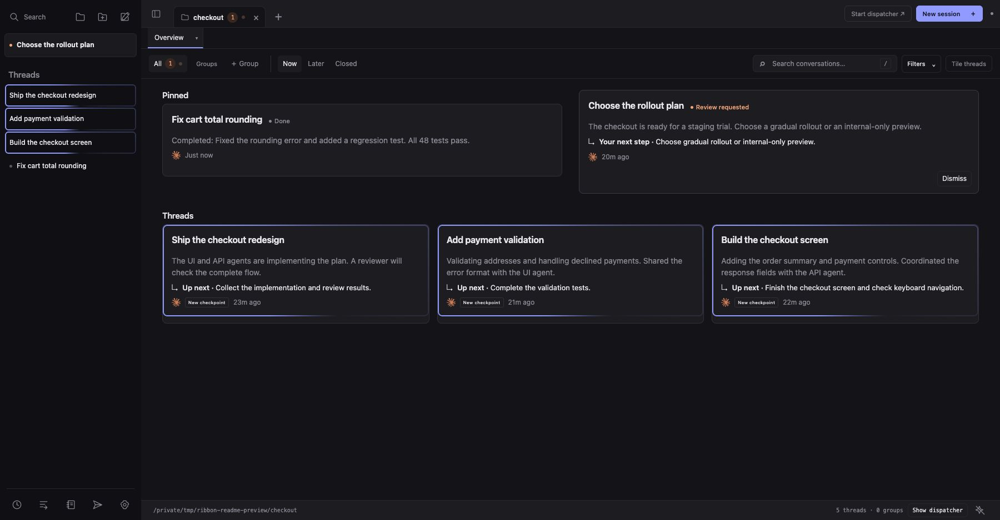
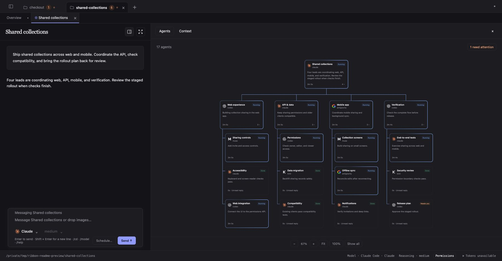
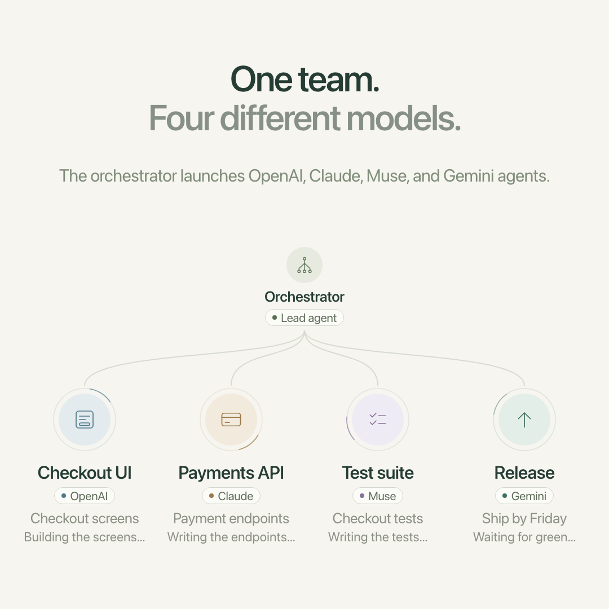

# Ribbon Field

**Let your agents work. Know when they need you.**

Ribbon Field is a workspace for running coding agents across projects and
providers. See what's running, what needs a decision, and where you left off.
Work with agents directly, or ask an orchestrator to coordinate a team.

[Download for macOS](https://ribbonfield.com/#download) ·
[Get started](#get-started) · [Technical reference](docs/reference.md)

*The app with sample conversations: keep work in view and see where you need to step in.*

## More work in motion. Less on your mind.

- **Know what needs you.** See questions, approvals, and blocked work alongside
  agents that can keep going. Organize conversations by project and set work
  aside for later.
- **Let your agents coordinate.** Agents can share context, declare which files
  they own, and hand work off. Ask an orchestrator to bring in specialists and
  report back with the result.
- **Pick up where you left off.** Keep conversations, progress summaries, and
  next steps together. Return to the agent that worked on something when you
  have a follow-up.

Use Codex, Claude Code, Google Antigravity, Kimi Code, and Muse Code in one app,
with your existing provider accounts and local projects.

## See agents working together

One request brings a team together. Agents coordinate changes, report the result,
and stay available for follow-ups.

*A sample team of 17 agents: one orchestrator, four leads, and their specialists.
Follow the work across providers and see which agent needs you.*

[Watch the 45-second explainer](docs/media/orchestration-demo.mp4).
An animated workflow illustration; the activity and results are simulated.

## Get started

1. [Download Ribbon Field](https://ribbonfield.com/#download) for Apple Silicon
   or Intel, drag it into **Applications**, and open it.
2. Have a supported coding-agent CLI installed and signed in. Start with Codex
   or Claude Code; Ribbon Field uses your existing account.
3. Open a project folder, start a conversation, and give an agent something
   useful to do. Start another task while it works, then return to the overview
   to see what needs you.

To try a team, ask:

> Use the orchestration skill to investigate this bug. Bring in another agent
> to review the proposed fix, and report back with your recommendation.

Requires macOS 12 or later. The app includes its runtime; you don't need to clone
this repository or install Python. Ribbon Field is currently in alpha.

## Go deeper

- [App installation and setup](desktop/macos/README.md#install-a-distributed-app)
- [Agent coordination and provider setup](docs/reference.md)
- [Dispatcher workflow](docs/dispatch.md)
- [Access your workspace from another device](docs/remote-access.md)
- [Development and validation](docs/reference.md#develop-and-validate)
- [Plugin installation](docs/reference.md#install) ·
  [Refreshing plugins after changes](docs/reference.md#refresh-installed-plugins-after-changes)

Ribbon Field is the app name. The CLI and plugins retain the **Agent Coord** name.
